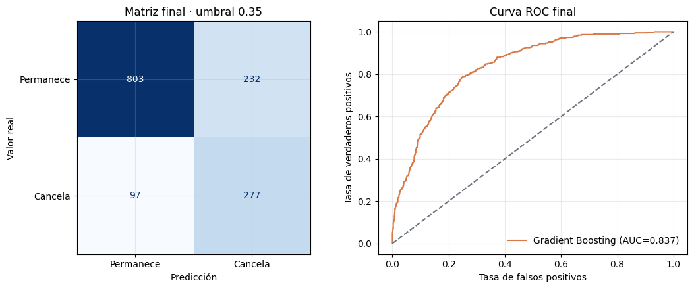
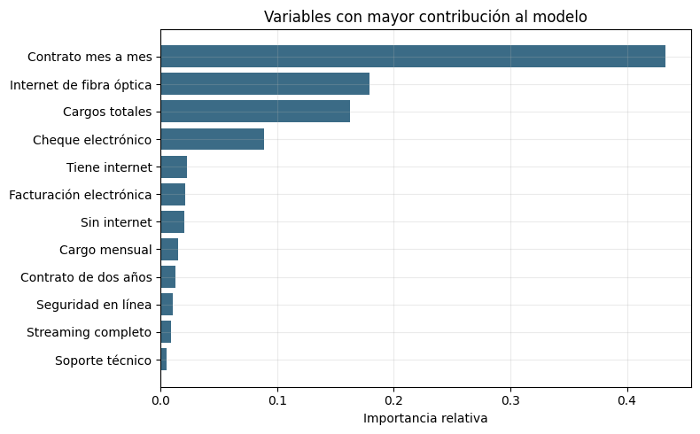
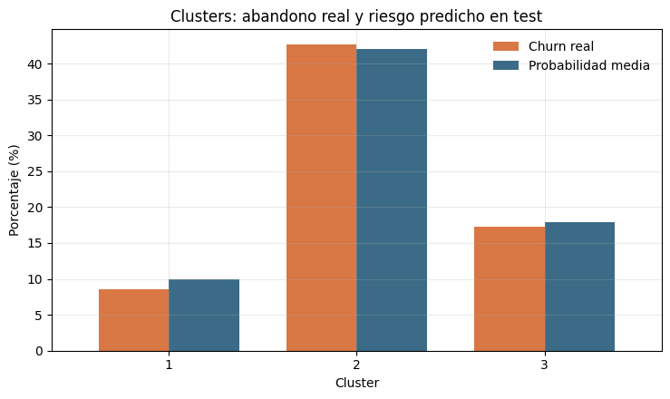

# Interconnect Customer Churn Prediction

End-to-end customer analysis, market segmentation and churn prediction for a telecommunications company.

**Final Data Science project · TripleTen**

**Author:** [Santiago Parada](https://github.com/santiagoparada)

[Open the complete notebook](notebooks/Interconnect_Churn_Prediction.ipynb)

## Project overview

Interconnect wants to identify customers with a high probability of cancelling their services so that the retention team can prioritize outreach. The project combines four customer-level datasets, explores churn patterns, creates three commercial segments and trains a supervised classification model.

The final solution uses a **Gradient Boosting classifier** and a business-oriented probability threshold. The model is intended for prioritization, not as an automated decision system.

| Result | Value |
|---|---:|
| Customers analyzed | 7,043 |
| Historical churn rate | 26.54% |
| Validation AUC-ROC | 0.860 |
| Test AUC-ROC | 0.837 |
| Test recall | 0.741 |
| Test precision | 0.544 |
| Decision threshold | 0.35 |
| Detected cancellations | 277 of 374 |

## Model performance



The threshold was selected using the validation set. Among thresholds reaching at least **75% recall**, the model chose the one with the highest precision. This produced a threshold of **0.35**. The rule reflects a retention use case where missing a likely cancellation is considered more costly than contacting an additional customer.

The test AUC-ROC improved from **0.809** with the provisional logistic regression to **0.837** with Gradient Boosting. The final test result is useful but remains below 0.85, so the project does not present the model as perfect or production-ready.

## Main business findings

- Customers with **month-to-month contracts**, **fiber-optic internet** and **electronic-check payments** showed the strongest historical association with churn.
- The high-risk commercial segment reached **42.63% observed churn** and a **42.01% mean predicted probability** in the test population.
- The model detected **82.71% of cancellations** within that high-risk segment.
- Gender and partner status were similar across segments; larger descriptive differences appeared for senior citizens and customers with dependents.
- The analysis describes associations and predictive signals. It does not establish that changing a contract or service will cause a customer to stay.



## Customer segmentation

K-Means was used independently from the supervised model to create three commercial profiles. `Churn` was not used to build the clusters, and the cluster label was not used as a model feature. Comparing both methods afterwards showed a coherent low-, medium- and high-risk ordering.



## Methodology

1. Audited and joined `contract`, `personal`, `internet` and `phone` by `customerID`.
2. Distinguished structural absence of a service from missing data.
3. Performed exploratory analysis of contracts, payments, charges, services and personal attributes.
4. Built three customer segments using K-Means and visualized them with PCA.
5. Created stratified training, validation and test sets.
6. Applied One-Hot Encoding and scaling inside a `Pipeline` fitted only on training data.
7. Compared logistic regression, Random Forest and controlled imbalance adjustments.
8. Tuned a small, readable set of Gradient Boosting configurations on validation data.
9. Selected the operating threshold using a minimum-recall business rule.
10. Evaluated the chosen model on the held-out test set and compared predictions with the customer segments.

## Project structure

```text
interconnect-churn-prediction/
├── README.md
├── requirements.txt
├── data/
│   ├── README.md
│   └── raw/                         # local only; ignored by Git
├── notebooks/
│   └── Interconnect_Churn_Prediction.ipynb
└── reports/
    └── figures/
        ├── model_evaluation.png
        ├── feature_importance.png
        └── cluster_risk_comparison.png
```

## Reproducing the analysis

1. Create a Python environment and install the dependencies:

   ```bash
   pip install -r requirements.txt
   ```

2. Place the four source files in `data/raw/`:

   ```text
   contract.csv
   personal.csv
   internet.csv
   phone.csv
   ```

3. Open `notebooks/Interconnect_Churn_Prediction.ipynb` and run all cells from the repository root or from `notebooks/`.

The notebook was executed successfully from top to bottom. The data files are not distributed in this repository because they were supplied for an educational project.

## Tools and techniques

- Python, pandas and NumPy
- Matplotlib
- scikit-learn
- Data validation and one-to-one joins
- Exploratory data analysis
- K-Means and PCA
- Logistic Regression, Random Forest and Gradient Boosting
- Pipelines, One-Hot Encoding and feature scaling
- AUC-ROC, recall, precision, F1 and threshold selection
- Feature importance and business interpretation

## Limitations and next steps

- The dataset contains one row per customer rather than historical snapshots, so it does not define a fully prospective prediction horizon.
- `TotalCharges` is used under the assumption that the accumulated amount is available at prediction time. If that assumption is not valid, the feature must be removed and the model retrained.
- `BeginDate` and `EndDate` are excluded from the model features.
- The threshold should be recalibrated when campaign costs, promotion costs and customer value become available.
- A future production study should validate the model on genuinely new customers and monitor performance over time.
